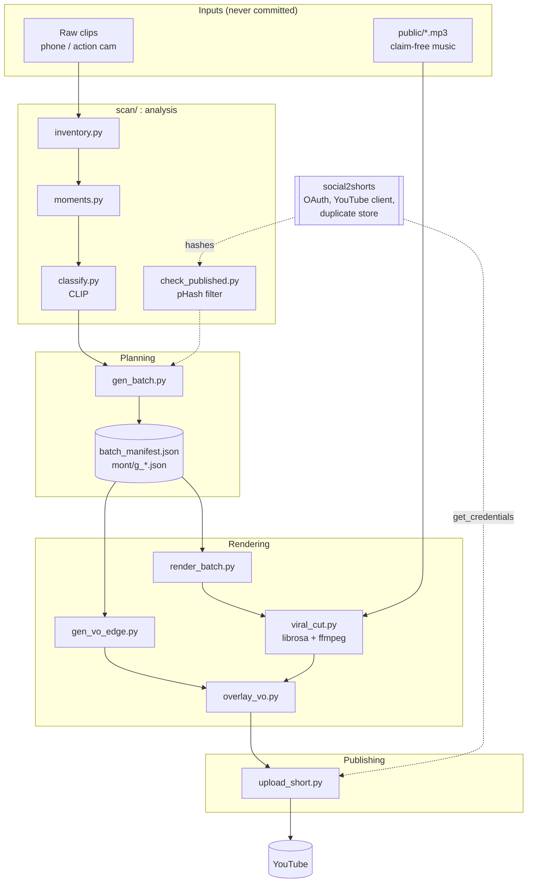

# Architecture

## Shape of the system

motoride-montage is a **file-based batch pipeline**. There is no server, database or long-running process.
Every stage is a standalone script that reads files from the previous stage and writes files for the next one,
which makes each stage re-runnable and easy to inspect, and also means the order is implicit
(see the [review](review.md)).

## Layers

| Layer | Code | Responsibility |
|---|---|---|
| Analysis | `scan/inventory.py`, `moments.py`, `classify.py`, `check_published.py` | turn footage into scored, tagged moments |
| Planning | `scan/gen_batch.py` | choose unique clips, copy, music and a publication schedule |
| Rendering | `viral_cut.py`, `scan/render_batch.py` | beat-synced cut, text, master |
| Audio | `scan/gen_vo_edge.py`, `scan/overlay_vo.py` | short voice, mixed under the music |
| Publishing | `upload_short.py`, `scan/_upload_launch.ps1` | quota-aware scheduled upload |
| Calm path | `src/`, `make_one.py`, `gen_batch_vo.py` | Remotion narrated renderer (secondary) |

## Contracts between stages

The JSON files are the interfaces:

| File | Producer | Consumers | Key fields |
|---|---|---|---|
| `scan/moments.jsonl` | `moments.py` | `classify.py`, `gen_batch.py` | `path`, `name`, `top4[{t,score}]`, `mean_bright`, `ok` |
| `scan/clip_tags.json` | `classify.py` | `gen_batch.py` | per path: `top`, `moto` |
| `scan/mont/<id>.json` | `gen_batch.py` | `viral_cut.py` | `[{clip,start,len,score}]` |
| `scan/batch_manifest.json` | `gen_batch.py` | `render_batch.py`, `gen_vo_edge.py`, `overlay_vo.py` | `id,theme,music,hook,outro,title,tags,target,publishAt` |
| `meta/<id>.json` | *(manual today)* | `upload_short.py` | `video,title,description,tags,categoryId,lang,privacy,publishAt` |

## Boundary with social2shorts

The two projects are **sibling repositories** with a one-way dependency: `motoride-montage` imports
`social2shorts.publish.youtube.get_credentials` and reads its `secrets/` and duplicate store.
social2shorts never imports this repository. Keep it that way: the OAuth token and the YouTube client live in
one place.

## Operating model

- **Idempotence by file existence**: renders skip outputs over 200 KB and `moments.py` resumes by line.
  The voice step (`gen_vo_edge.py`) and `overlay_vo.py` are **not** idempotent; see the review.
- **Timeouts**: inventory, moments, rendering (240 s) and the voice mix (120 s) have timeouts. Classification
  and `build_montages.py` do not yet.
- **Windows host**: paths, `NUL`, fonts and `taskkill` assume Windows today.
- **Unattended uploads**: the PowerShell launcher starts `upload_short.py` detached so it survives the
  terminal closing; it retries on quota limits for up to 30 h. The PC must stay on.
