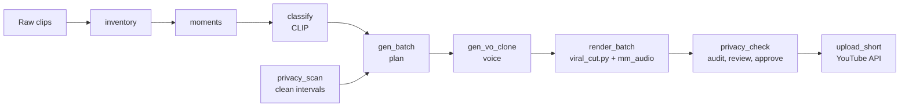

# motoride-montage

**motoride-montage** turns hours of raw moto footage into **viral-style YouTube Shorts**: it scans your
rushes, scores the strongest moments, cuts them **on the beat** of modern, motivating claim-free music, adds a hook, a
closing line and a light voice, then uploads everything at the pace YouTube allows.

It is the **montage engine** that sits next to [social2shorts](https://github.com/m-elkhou/social2shorts)
(which handles catalog re-publishing, OAuth and the YouTube client).

## What it does

| Stage | Script | Result |
|---|---|---|
| Inventory | `scan/inventory.py` | list of every clip (size, duration, resolution) |
| Moments | `scan/moments.py` | best 2 s / 4 s windows per clip (motion, sharpness, audio, light) |
| Classification | `scan/classify.py` | zero-shot CLIP tag + "moto score" per clip |
| Privacy gate | `scan/privacy_scan.py`, `scan/privacy_check.py` | **only intervals with no visible face and no bystander**; audit, review, approval |
| Planning | `scan/gen_batch.py` | N themed montages from the clean intervals, **zero clip reuse**, hooks, titles, schedule |
| Rendering | `scan/render_batch.py` → `viral_cut.py` | 1080x1920, 30 fps, beat-synced, slow-mo on the drop |
| Voice | `scan/gen_vo_clone.py` + `mm_audio.py` | the owner's cloned voice, treated and mixed over a ducked music in one pass |
| Metadata | `scan/make_meta.py` | `meta/<id>.json` with your signature and hashtags |
| Upload | `upload_short.py` | scheduled, quota-aware YouTube upload with a per-upload ledger |

One command chains them: `python run_pipeline.py` (see [Getting started](getting-started.md)).

## Design principles

- **Moments over beauty.** Views come from the *moment*, not image quality (see [Viral DNA](viral-dna.md)).
- **Claim-free music only.** Trending commercial tracks get Content ID claims through the API; the
  engine uses the YouTube Audio Library, ranked for energy and mood ([Music](pipeline/music.md)).
- **Never republish.** Clips are used once across all montages; published clips are filtered by perceptual hash.
- **Your data stays yours.** Footage, music, tokens and channel data are never committed ([Security](security.md)).

!!! info "Status"
    A working personal tool. The [architecture review](review.md) lists each finding with its status (most were
    fixed on the day of the review, with 34 tests and CI on Linux and Windows); two design decisions remain open.
